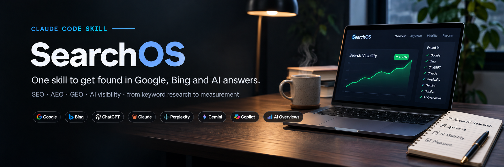
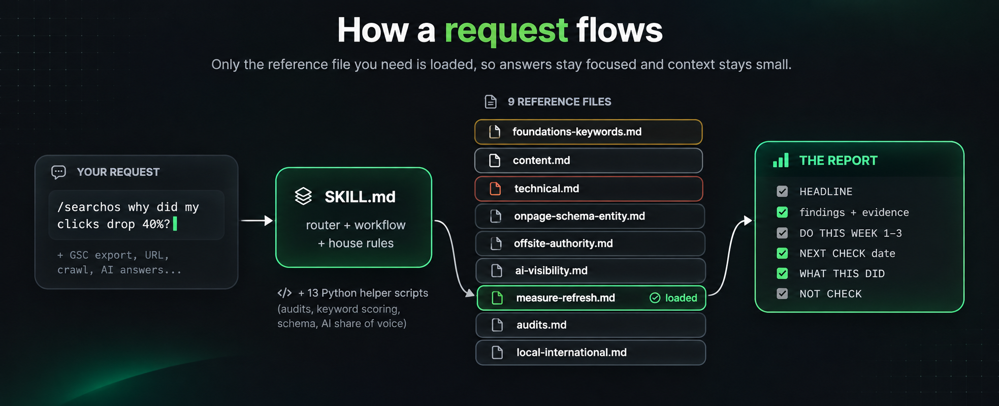
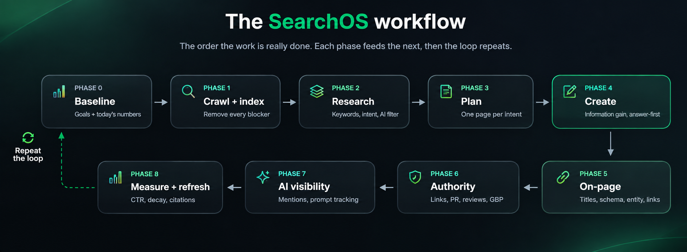
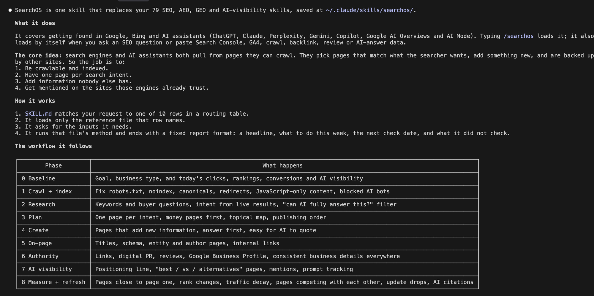
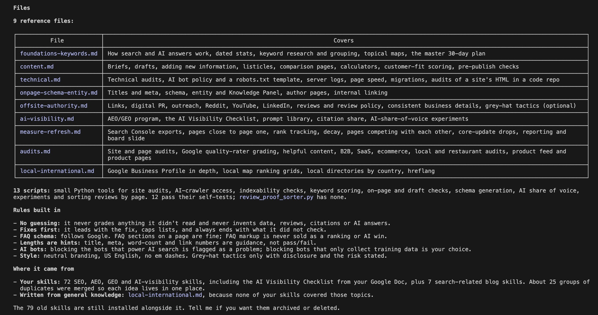

<div align="center">



<br>

[](LICENSE)
[](https://docs.claude.com/en/docs/claude-code)
[](scripts)
[](https://github.com/vamsireddy4/claude-watch)
[](https://github.com/vamsireddy4/search-os/stargazers)

**Stop juggling 80 SEO prompts. Install one skill that knows the whole job.**

[Install](#install-in-10-seconds) · [What it does](#what-it-does) · [How it works](#how-it-works) · [Examples](#try-these) · [What's inside](#whats-inside) · [claude-watch](#built-with-claude-watch)

</div>

---

## What it does

SearchOS turns Claude Code into a senior search strategist. It covers **SEO, AEO (answer-engine optimization), GEO
(generative-engine optimization) and AI visibility** in one skill: keyword research, content, technical audits,
schema, internal links, backlinks, reviews, local SEO, AI citation tracking and reporting.

It works for **Google, Bing, ChatGPT, Claude, Perplexity, Gemini, Copilot and Google AI Overviews / AI Mode**.

It was built by studying **~80 separate SEO, AEO, GEO and AI-visibility skills**, merging **~25 groups of duplicates**,
resolving their conflicts, and rewriting everything as one workflow with one set of rules.

> **The idea:** search engines and AI assistants both pull from pages they can crawl, then pick pages that match the
> searcher's intent, add something new, and are backed up by other sites. So: be crawlable, build one page per intent,
> add information nobody else has, and get named where those engines already look.

### Why people use it

| Without SearchOS | With SearchOS |
|---|---|
| A different prompt or skill for every SEO task | One `/searchos` that routes every task to the right method |
| Generic "improve your content" advice | Exact page, exact issue, exact fix, ready to paste |
| Made-up numbers and confident guesses | Never invents data; marks what it couldn't check |
| Old myths (keyword density, FAQ schema hacks, word-count targets) | Current Google guidance; myths called out |
| SEO and AI search treated separately | One loop: rank in search, get cited by AI, measure both |

---

## Install in 10 seconds

```bash
git clone https://github.com/vamsireddy4/search-os.git ~/.claude/skills/searchos
```

Start a new [Claude Code](https://docs.claude.com/en/docs/claude-code) session. Done.

> Needs Claude Code. The helper scripts use Python 3 standard library only: nothing to `pip install`.

---

## How it works

<div align="center">

</div>

1. **You ask** with `/searchos ...` or just ask a search question (it also loads when you paste Search Console, GA4,
   crawl, backlink, review or AI-answer data).
2. **The router** in `SKILL.md` picks the right workflow.
3. **Only one reference file loads**, so Claude stays focused and your context stays small.
4. **You get a report** with the same shape every time:

```text
[REPORT NAME]: [site / page / query], [date], data: [fetched / pasted / export]
HEADLINE: the biggest issue or result
...findings with evidence...
DO THIS WEEK: 1-3 actions, smallest effort / biggest impact first
NEXT CHECK: date and what to re-run
WHAT THIS DID NOT CHECK: gaps, and the export or tool that would answer each
```

### The workflow

<div align="center">

</div>

Audits are entry points into this loop: they find which phase is broken, then SearchOS fixes it in order.

---

## Try these

```text
/searchos plan SEO for my new bakery website in Pune
/searchos here's my Search Console export, why did clicks drop 40% since June?
/searchos audit https://example.com for technical issues
/searchos write a comparison page: our tool vs Asana for agencies
/searchos how do I get ChatGPT and Perplexity to recommend us?
/searchos run the AI visibility checklist on example.com
/searchos find striking-distance keywords in this GSC export
/searchos generate Organization and LocalBusiness schema for this page
/searchos grade this page like a Google quality rater for "best crm for startups"
```

### See it in Claude Code

<div align="center">

<br><sub>Asking Claude Code to explain SearchOS: what it does, how it routes, and the workflow it follows.</sub>
<br><br>

<br><sub>The reference files, helper scripts and rules built into the skill.</sub>
</div>

---

## What's inside

| Area | File | Covers |
|---|---|---|
| Strategy | [`foundations-keywords.md`](references/foundations-keywords.md) | How search + AI answers work, dated stats, keyword research, intent, clustering, topical maps, master 30-day plan |
| Content | [`content.md`](references/content.md) | Briefs, drafts, information gain, listicles, comparison pages, calculators, customer-fit scoring, pre-publish checks |
| Technical | [`technical.md`](references/technical.md) | Technical audits, AI bot policy + robots.txt template, server logs, Core Web Vitals, migrations, repo HTML audits |
| On-page | [`onpage-schema-entity.md`](references/onpage-schema-entity.md) | Titles and meta, schema (JSON-LD), entity / Knowledge Panel, author authority, internal linking |
| Authority | [`offsite-authority.md`](references/offsite-authority.md) | Link building, digital PR, outreach, Reddit / YouTube / LinkedIn, reviews and Google review policy |
| AI visibility | [`ai-visibility.md`](references/ai-visibility.md) | AEO/GEO program, AI Visibility Checklist, prompt library, citation share, share-of-voice experiments |
| Measure | [`measure-refresh.md`](references/measure-refresh.md) | Search Console, striking distance, rank tracking, content decay, cannibalization, core updates, board slide |
| Audits | [`audits.md`](references/audits.md) | Site and page audits, quality-rater grading, helpful content, B2B / SaaS / ecommerce / local / restaurant |
| Local + global | [`local-international.md`](references/local-international.md) | Google Business Profile, local map grids, citations by country, hreflang and multilingual sites |

### 13 helper scripts

Run with `python3 ~/.claude/skills/searchos/scripts/<name>.py`. Each has a `--selftest` (except `review_proof_sorter.py`).

| Script | What it does |
|---|---|
| `site_audit.py` | Site-wide technical + AI-access audit: host, redirects, soft 404, sitemap, canonicals, raw HTML, schema |
| `ai_crawl_check.py` | Which AI bots robots.txt blocks (search vs training), llms.txt, text visible without JavaScript |
| `check_indexable.py` | noindex, X-Robots-Tag and robots.txt checks for search bots |
| `keyword_score.py` | Scores keywords by traffic potential, business value and difficulty, with an AI-answer discount |
| `pick_keywords.py` | Finds winnable buying-intent long-tail keywords |
| `onpage_check.py` | On-page basics for one page |
| `draft_check.py` | Pre-publish check: answer first, keyword placement; structure and length as notes |
| `ready_check.py` | Placeholders, image alt text, author/reviewer, evidence density |
| `quotable_check.py` | How easily AI can quote each passage |
| `entity_schema.py` | Organization + WebSite JSON-LD with sameAs links |
| `aeo_gaps.py` | AI share of voice per engine and gap queries from pasted AI answers |
| `sov_experiment.py` | Test vs control lift with a permutation p-value |
| `review_proof_sorter.py` | Sorts Google reviews into proof blocks for each service or location page |

---

## Rules it always follows

- **Read or stop.** Never grades a page, site, search result or AI answer it didn't actually read.
- **Never invents data.** No made-up volumes, rankings, reviews, citations or AI answers. Gaps are marked `[ADD: ...]`.
- **Leads with the fix.** Exact page, exact change, short lists, patterns over single pages.
- **Says what it didn't check.** Every report ends with it.
- **No guarantees.** Directions and re-check dates, never promised rankings.
- **Soft numbers stay soft.** Title (~60 chars), meta (~155), word and link counts are hints, not pass/fail.
- **Schema honesty.** Markup must match the page. FAQ rich results ended 7 May 2026, so FAQ markup is never sold as
  a ranking or AI win. There is no special "AI schema".
- **AI bots.** Blocking AI search bots is a problem; blocking training-only bots is the owner's choice.
- **White-hat by default.** Grey-hat tactics live in one optional section, with disclosure and risks stated.
- **Asks first** before paid API calls, sending emails, editing a live site or committing code.

---

## Built with claude-watch

<div align="center">

**A big thank you to [claude-watch](https://github.com/vamsireddy4/claude-watch).**

</div>

Much of what SearchOS knows came from SEO, AEO and GEO courses and talks on video. I used
**[claude-watch](https://github.com/vamsireddy4/claude-watch)**, an Agent Skill that lets Claude (and Codex, Gemini
CLI, Cursor) watch a video from any URL as key frames plus a timestamped transcript, to watch those videos and turn
each one into a skill. SearchOS is what you get when ~80 of those learned skills are merged into one.

If you want your agent to learn from videos too, give it a look:

```bash
git clone https://github.com/vamsireddy4/claude-watch
```

---

## Limits

- It can't query AI assistants itself: AI visibility is measured from answers you paste or from a tracking tool.
- Third-party statistics are dated and directional; re-check before quoting them.
- Google changes some features often (Business Profile posts and Q&A, rich result types); verify before relying on them.
- Not covered: paid search campaigns, faceted-navigation decision trees beyond ecommerce basics.

---

## Contributing

Found an outdated rule, a better method, or a bug in a script? Issues and pull requests are welcome.
Please keep the house rules: cite sources for numbers, no invented data, no vendor promotion.

If SearchOS helps you, **⭐ star the repo** so more people can find it.

---

## Credits

SearchOS distills methods from public SEO and AI-search teaching (including Google Search Central documentation and
the Search Quality Rater Guidelines, plus community courses and skills on SEO, AEO and GEO), rewritten in its own
words. Not affiliated with Google, Microsoft, OpenAI, Anthropic, Ahrefs or any other company mentioned.

## License

[MIT](LICENSE): free to use, modify and share, including commercially.
